---
tags:
  - progress
---
<!-- Generated by tools/build-obsidian-plan.py. Edit docs/team-plan.json instead. -->

# Progress

**The vault is the source of truth for progress.** You can open every task
below to see its sub-tasks. These checkboxes are the list in the task note
itself. This note shows that list, and does not copy it. Thus, if you tick
a box here, you also tick the same box in the task note.

The counts and the ✅ 🟡 ⬜ marks are a snapshot. To update them, run
`python3 tools/build-obsidian-plan.py`.

**73 of 301 done · 24%**

`██████░░░░░░░░░░░░░░░░░░`

This note is part of [[roomsie launch]].

| Lane | Tasks complete | Items | Done |
|---|---|---|---|
| [[P1 Platform]] | 5 / 11 | 16 / 35 | 46% |
| [[P2 Chat]] | 0 / 13 | 0 / 60 | 0% |
| [[P3 Data and trust]] | 4 / 15 | 21 / 70 | 30% |
| [[P4 Content and moderation]] | 1 / 8 | 6 / 31 | 19% |
| [[P5 Accounts and people]] | 1 / 6 | 4 / 29 | 14% |
| [[Design]] | 4 / 6 | 8 / 11 | 73% |
| [[M1 Content]] | 0 / 3 | 0 / 6 | 0% |
| [[M2 Community]] | 0 / 4 | 0 / 13 | 0% |
| [[Founder]] | 6 / 14 | 18 / 41 | 44% |
| [[Everyone]] | 0 / 2 | 0 / 5 | 0% |

---

## Design-free work

Take tasks from this section. No task here waits on a design or on an open product call. This list comes from the `deps` in `docs/team-plan.json`.

- **You can start wave 0 at this time.** Its tasks wait on no open task.
- **Wave n waits on wave n−1.** When a wave is complete, you can start the next wave.
- **Many people can work on one wave.** Each person does one task at a time.
- **To take a task, assign its issue to you.** First, make sure that the issue has no assignee.
- **In a wave, take the ⚑ tasks first.** Then take the task that unblocks the most tasks.
- **The F- tasks with the word "calls" are grill sessions with the product team.** Each one has a question file in `docs/product-calls/`.
- **When the product team completes a product-call task,** the tasks in "Waits on product calls" that wait on it join the waves.
- **When a design task is done,** the tasks in "Waits on the designs" that need it join the waves.

**45 free tasks are open · 177 build hours.**

| Wave | Task | Owner | Hours | State | Unblocks | Issue |
|---|---|---|---|---|---|---|
| 0 | [[T-08 Form A contract ⚑]] | P2 | 2 | ⬜ can start | 20 | [#6](https://github.com/magentawood/roomsie/issues/6) |
| 0 | [[T-18a Message request API ⚑]] | P5 | 4 | ⬜ can start | 3 | [#38](https://github.com/magentawood/roomsie/issues/38) |
| 0 | [[T-16a Profile API ⚑]] | P5 | 5 | ⬜ can start | 2 | [#36](https://github.com/magentawood/roomsie/issues/36) |
| 0 | [[T-10 Chat screen and split view ⚑]] | P2 | 8 | ⬜ can start | 1 | [#12](https://github.com/magentawood/roomsie/issues/12) |
| 0 | [[T-18b Person and connect screens ⚑]] | P3 | 4 | ⬜ can start | 0 | [#44](https://github.com/magentawood/roomsie/issues/44) |
| 0 | [[F-06 Launch areas picked]] | F |  | ⬜ can start | 5 | [#9](https://github.com/magentawood/roomsie/issues/9) |
| 0 | [[M-04 Article interviews]] | M1 |  | ⬜ can start | 2 | [#13](https://github.com/magentawood/roomsie/issues/13) |
| 0 | [[T-24 Event logging]] | P5 | 2 | ⬜ can start | 2 | [#37](https://github.com/magentawood/roomsie/issues/37) |
| 0 | [[F-07 Privacy and terms draft]] | F |  | ⬜ can start | 1 | [#17](https://github.com/magentawood/roomsie/issues/17) |
| 0 | [[T-37 Articles and search]] | P4 | 3 | ⬜ can start | 1 | [#66](https://github.com/magentawood/roomsie/issues/66) |
| 0 | [[F-14 Assistant and limits calls]] | F |  | ⬜ can start | 0 | [#106](https://github.com/magentawood/roomsie/issues/106) |
| 0 | [[M-03 Eval sentences]] | P5 | 4 | ⬜ can start | 0 | [#21](https://github.com/magentawood/roomsie/issues/21) |
| 0 | [[T-07 Error reporting]] | P1 | 1 | ⬜ can start | 0 | [#28](https://github.com/magentawood/roomsie/issues/28) |
| 0 | [[T-23a Landing page]] | P4 | 4 | ⬜ can start | 0 | [#39](https://github.com/magentawood/roomsie/issues/39) |
| 0 | [[T-33 Invite-only gate]] | P1 | 1 | ⬜ can start | 0 | [#29](https://github.com/magentawood/roomsie/issues/29) |
| 0 | [[T-40 Nightly backups]] | P1 | 2 | ⬜ can start | 0 | [#69](https://github.com/magentawood/roomsie/issues/69) |
| 0 | [[T-42 Listing flow screens]] | P3 | 8 | 🟡 in progress | 0 | [#118](https://github.com/magentawood/roomsie/issues/118) |
| 0 | [[T-43 Listing detail screens]] | P3 | 5 | ⬜ can start | 0 | [#119](https://github.com/magentawood/roomsie/issues/119) |
| 0 | [[T-46 ID verification]] | P3 | 12 | ⬜ can start | 0 | [#122](https://github.com/magentawood/roomsie/issues/122) |
| 0 | [[T-52 Web CSP]] | P1 | 3 | ⬜ can start | 0 | [#135](https://github.com/magentawood/roomsie/issues/135) |
| 0 | [[T-53 Delete the Firebase user]] | P4 | 2 | ⬜ can start | 0 | [#143](https://github.com/magentawood/roomsie/issues/143) |
| 1 | [[T-11 Model wrapper ⚑]] | P2 | 4 | ⬜ waits | 10 | [#15](https://github.com/magentawood/roomsie/issues/15) |
| 1 | [[T-14 Match query ⚑]] | P3 | 6 | 🟡 in progress | 6 | [#27](https://github.com/magentawood/roomsie/issues/27) |
| 1 | [[T-15 Results panel ⚑]] | P3 | 6 | ⬜ waits | 2 | [#16](https://github.com/magentawood/roomsie/issues/16) |
| 1 | [[T-16b Profile screens ⚑]] | P5 | 3 | ⬜ waits | 1 | [#98](https://github.com/magentawood/roomsie/issues/98) |
| 1 | [[T-09 Chip flow ⚑]] | P2 | 6 | ⬜ waits | 0 | [#26](https://github.com/magentawood/roomsie/issues/26) |
| 1 | [[M-05 Article drafts]] | M1 |  | ⬜ waits | 1 | [#31](https://github.com/magentawood/roomsie/issues/31) |
| 1 | [[T-35 Form B contract]] | P2 | 3 | ⬜ waits | 1 | [#64](https://github.com/magentawood/roomsie/issues/64) |
| 1 | [[T-44 Messages API]] | P3 | 8 | ⬜ waits | 1 | [#120](https://github.com/magentawood/roomsie/issues/120) |
| 1 | [[T-23b Legal pages]] | P4 | 2 | ⬜ waits | 0 | [#40](https://github.com/magentawood/roomsie/issues/40) |
| 1 | [[T-39 Analytics database]] | P1 | 3 | ⬜ waits | 0 | [#68](https://github.com/magentawood/roomsie/issues/68) |
| 1 | [[T-48 Onboarding questions]] | P3 | 5 | ⬜ waits | 0 | [#124](https://github.com/magentawood/roomsie/issues/124) |
| 2 | [[T-12 Extraction ⚑]] | P2 | 6 | ⬜ waits | 6 | [#23](https://github.com/magentawood/roomsie/issues/23) |
| 2 | [[T-13 Reply writer]] | P2 | 4 | ⬜ waits | 1 | [#33](https://github.com/magentawood/roomsie/issues/33) |
| 2 | [[T-19 Report and block]] | P4 | 5 | ⬜ waits | 0 | [#45](https://github.com/magentawood/roomsie/issues/45) |
| 2 | [[T-38 Advisor]] | P2 | 7 | ⬜ waits | 0 | [#67](https://github.com/magentawood/roomsie/issues/67) |
| 2 | [[T-45 Messages screens]] | P3 | 6 | ⬜ waits | 0 | [#121](https://github.com/magentawood/roomsie/issues/121) |
| 2 | [[T-50 Found a place, share, feedback]] | P3 | 4 | ⬜ waits | 0 | [#126](https://github.com/magentawood/roomsie/issues/126) |
| 3 | [[T-34 Router ⚑]] | P2 | 6 | ⬜ waits | 0 | [#63](https://github.com/magentawood/roomsie/issues/63) |
| 3 | [[T-21 Turn cap and spend ceiling]] | P2 | 5 | ⬜ waits | 1 | [#41](https://github.com/magentawood/roomsie/issues/41) |
| 3 | [[T-17 Carry chat into account]] | P2 | 2 | ⬜ waits | 0 | [#32](https://github.com/magentawood/roomsie/issues/32) |
| 3 | [[T-27 Eval run]] | P2 | 3 | ⬜ waits | 0 | [#48](https://github.com/magentawood/roomsie/issues/48) |
| 3 | [[T-36 Observer]] | P2 | 8 | ⬜ waits | 0 | [#65](https://github.com/magentawood/roomsie/issues/65) |
| 3 | [[T-49 Compare cards]] | P3 | 4 | ⬜ waits | 0 | [#125](https://github.com/magentawood/roomsie/issues/125) |
| 4 | [[T-29 Abuse test]] | P1 | 1 | ⬜ waits | 0 | [#51](https://github.com/magentawood/roomsie/issues/51) |

### Waits on product calls

| Task | Owner | Hours | Waits on | Issue |
|---|---|---|---|---|
| [[T-22a Waitlist API]] | P4 | 2 | F-06 | [#47](https://github.com/magentawood/roomsie/issues/47) |
| [[T-22b Waitlist screen]] | P4 | 1 | F-06 | [#99](https://github.com/magentawood/roomsie/issues/99) |

### Waits on the designs

| Task | Owner | Hours | Waits on | Issue |
|---|---|---|---|---|

### Graph

Blue can start. Yellow is in progress. Green is done. White waits on a different task. Purple waits on a product call. Grey waits on a design. Pink is a design task.

```mermaid
flowchart LR
  F03["F-03<br/>Billing and caps"]:::done
  F04["F-04<br/>Accounts in Mumbai"]:::done
  F06["F-06<br/>Launch areas picked"]:::ready
  F07["F-07<br/>Privacy and terms draft"]:::ready
  F11["F-11 ⚑<br/>Intake and profile calls"]:::done
  F12["F-12 ⚑<br/>Matching calls"]:::done
  F13["F-13 ⚑<br/>Connect and trust calls"]:::done
  F14["F-14<br/>Assistant and limits calls"]:::ready
  M04["M-04<br/>Article interviews"]:::ready
  M05["M-05<br/>Article drafts"]:::todo
  T08["T-08 ⚑<br/>Form A contract"]:::ready
  T02["T-02 ⚑<br/>Scaffold monorepo"]:::done
  T18b["T-18b ⚑<br/>Person and connect screens"]:::ready
  T06["T-06 ⚑<br/>Database schema"]:::done
  T10["T-10 ⚑<br/>Chat screen and split view"]:::ready
  T11["T-11 ⚑<br/>Model wrapper"]:::todo
  T05["T-05 ⚑<br/>Google sign-in"]:::done
  T15["T-15 ⚑<br/>Results panel"]:::todo
  M03["M-03<br/>Eval sentences"]:::ready
  T12["T-12 ⚑<br/>Extraction"]:::todo
  T09["T-09 ⚑<br/>Chip flow"]:::todo
  T14["T-14 ⚑<br/>Match query"]:::doing
  T04["T-04<br/>Deploy to Mumbai"]:::done
  T16a["T-16a ⚑<br/>Profile API"]:::ready
  T16b["T-16b ⚑<br/>Profile screens"]:::todo
  T03["T-03<br/>CI checks"]:::done
  T13["T-13<br/>Reply writer"]:::todo
  T07["T-07<br/>Error reporting"]:::ready
  T17["T-17<br/>Carry chat into account"]:::todo
  T19["T-19<br/>Report and block"]:::todo
  T33["T-33<br/>Invite-only gate"]:::ready
  T23a["T-23a<br/>Landing page"]:::ready
  T24["T-24<br/>Event logging"]:::ready
  T21["T-21<br/>Turn cap and spend ceiling"]:::todo
  T18a["T-18a ⚑<br/>Message request API"]:::ready
  T20["T-20<br/>Account deletion"]:::done
  T53["T-53<br/>Delete the Firebase user"]:::ready
  T54["T-54<br/>Photos domain"]:::done
  T23b["T-23b<br/>Legal pages"]:::todo
  T25["T-25<br/>Uptime monitor"]:::done
  T27["T-27<br/>Eval run"]:::todo
  T29["T-29<br/>Abuse test"]:::todo
  T34["T-34 ⚑<br/>Router"]:::todo
  T35["T-35<br/>Form B contract"]:::todo
  T36["T-36<br/>Observer"]:::todo
  T37["T-37<br/>Articles and search"]:::ready
  T38["T-38<br/>Advisor"]:::todo
  T39["T-39<br/>Analytics database"]:::todo
  T40["T-40<br/>Nightly backups"]:::ready
  T41["T-41<br/>Listings API"]:::done
  T42["T-42<br/>Listing flow screens"]:::doing
  T43["T-43<br/>Listing detail screens"]:::ready
  T44["T-44<br/>Messages API"]:::todo
  T45["T-45<br/>Messages screens"]:::todo
  T46["T-46<br/>ID verification"]:::ready
  T47["T-47<br/>Saved"]:::done
  T48["T-48<br/>Onboarding questions"]:::todo
  T49["T-49<br/>Compare cards"]:::todo
  T50["T-50<br/>Found a place, share, feedback"]:::todo
  T51["T-51 ⚑<br/>Migrations in the deploy"]:::done
  T52["T-52<br/>Web CSP"]:::ready
  T22a["T-22a<br/>Waitlist API"]:::product
  T22b["T-22b<br/>Waitlist screen"]:::product
  F03 --> F04
  F13 --> F07
  M04 --> M05
  F11 --> T08
  D03 -.-> T18b
  F13 --> T18b
  F11 --> T06
  D02 -.-> T10
  T08 --> T11
  F04 --> T11
  T02 --> T05
  F04 --> T05
  T06 --> T05
  T08 --> T15
  D03 -.-> T15
  F12 --> T15
  T11 --> T12
  T10 --> T09
  T08 --> T09
  D02 -.-> T09
  T06 --> T14
  T08 --> T14
  F12 --> T14
  T02 --> T04
  F04 --> T04
  T05 --> T16a
  T06 --> T16a
  F11 --> T16a
  T16a --> T16b
  D03 -.-> T16b
  T20 --> T16b
  T02 --> T03
  T11 --> T13
  T02 --> T07
  F04 --> T07
  T05 --> T17
  T06 --> T17
  T12 --> T17
  T06 --> T19
  T14 --> T19
  T05 --> T33
  D04 -.-> T23a
  T12 --> T21
  T06 --> T21
  T05 --> T21
  T05 --> T18a
  T06 --> T18a
  F13 --> T18a
  T06 --> T20
  T20 --> T53
  T41 --> T54
  T02 --> T23b
  F07 --> T23b
  T04 --> T25
  T12 --> T27
  T21 --> T29
  T12 --> T34
  T06 --> T34
  T06 --> T35
  T08 --> T35
  T35 --> T36
  T12 --> T36
  T06 --> T36
  T06 --> T37
  T37 --> T38
  T11 --> T38
  T05 --> T38
  M05 --> T38
  T24 --> T39
  T04 --> T40
  F04 --> T40
  T05 --> T41
  T06 --> T41
  F11 --> T41
  T41 --> T42
  T41 --> T43
  D03 -.-> T43
  T05 --> T44
  T06 --> T44
  T18a --> T44
  F13 --> T44
  T20 --> T44
  T44 --> T45
  T05 --> T46
  T06 --> T46
  F13 --> T46
  T41 --> T47
  T05 --> T47
  T06 --> T47
  T05 --> T48
  T08 --> T48
  F11 --> T48
  T13 --> T49
  T15 --> T49
  T15 --> T50
  T24 --> T50
  T04 --> T51
  T06 --> T51
  T05 --> T52
  T14 --> T22a
  F06 --> T22a
  T22a --> T22b
  D04 -.-> T22b
  classDef done fill:#2ea44f,color:#fff,stroke:#2ea44f
  classDef doing fill:#e3b341,color:#000,stroke:#e3b341
  classDef ready fill:#3b82f6,color:#fff,stroke:#3b82f6
  classDef todo fill:#fff,color:#000,stroke:#8b949e
  classDef design fill:#eee,color:#888,stroke:#bbb,stroke-dasharray:4
  classDef product fill:#f3e8ff,color:#6b21a8,stroke:#a855f7,stroke-dasharray:4
  classDef dtask fill:#ff87ac,color:#000,stroke:#ff87ac
```

---

## P1 Platform — 16/35

> [!todo]- ✅ [[T-02 Scaffold monorepo ⚑]] · 6/6
> ![[T-02 Scaffold monorepo ⚑#^done]]

> [!todo]- ✅ [[T-05 Google sign-in ⚑]] · 3/3
> ![[T-05 Google sign-in ⚑#^done]]

> [!todo]- ✅ [[T-04 Deploy to Mumbai]] · 3/3
> ![[T-04 Deploy to Mumbai#^done]]

> [!todo]- ⬜ [[T-07 Error reporting]] · 0/3
> ![[T-07 Error reporting#^done]]

> [!todo]- ✅ [[T-25 Uptime monitor]] · 1/1
> ![[T-25 Uptime monitor#^done]]

> [!todo]- ⬜ [[T-33 Invite-only gate]] · 0/2
> ![[T-33 Invite-only gate#^done]]

> [!todo]- ⬜ [[T-39 Analytics database]] · 0/5
> ![[T-39 Analytics database#^done]]

> [!todo]- ⬜ [[T-40 Nightly backups]] · 0/3
> ![[T-40 Nightly backups#^done]]

> [!todo]- ⬜ [[T-29 Abuse test]] · 0/3
> ![[T-29 Abuse test#^done]]

> [!todo]- ✅ [[T-51 Migrations in the deploy ⚑]] · 3/3
> ![[T-51 Migrations in the deploy ⚑#^done]]

> [!todo]- ⬜ [[T-52 Web CSP]] · 0/3
> ![[T-52 Web CSP#^done]]

## P2 Chat — 0/60

> [!todo]- ⬜ [[T-08 Form A contract ⚑]] · 0/5
> ![[T-08 Form A contract ⚑#^done]]

> [!todo]- ⬜ [[T-11 Model wrapper ⚑]] · 0/4
> ![[T-11 Model wrapper ⚑#^done]]

> [!todo]- ⬜ [[T-35 Form B contract]] · 0/3
> ![[T-35 Form B contract#^done]]

> [!todo]- ⬜ [[T-12 Extraction ⚑]] · 0/6
> ![[T-12 Extraction ⚑#^done]]

> [!todo]- ⬜ [[T-34 Router ⚑]] · 0/4
> ![[T-34 Router ⚑#^done]]

> [!todo]- ⬜ [[T-13 Reply writer]] · 0/5
> ![[T-13 Reply writer#^done]]

> [!todo]- ⬜ [[T-36 Observer]] · 0/6
> ![[T-36 Observer#^done]]

> [!todo]- ⬜ [[T-21 Turn cap and spend ceiling]] · 0/6
> ![[T-21 Turn cap and spend ceiling#^done]]

> [!todo]- ⬜ [[T-38 Advisor]] · 0/5
> ![[T-38 Advisor#^done]]

> [!todo]- ⬜ [[T-27 Eval run]] · 0/4
> ![[T-27 Eval run#^done]]

> [!todo]- ⬜ [[T-17 Carry chat into account]] · 0/4
> ![[T-17 Carry chat into account#^done]]

> [!todo]- ⬜ [[T-10 Chat screen and split view ⚑]] · 0/5
> ![[T-10 Chat screen and split view ⚑#^done]]

> [!todo]- ⬜ [[T-09 Chip flow ⚑]] · 0/3
> ![[T-09 Chip flow ⚑#^done]]

## P3 Data and trust — 21/70

> [!todo]- ✅ [[T-06 Database schema ⚑]] · 7/7
> ![[T-06 Database schema ⚑#^done]]

> [!todo]- 🟡 [[T-14 Match query ⚑]] · 1/8
> ![[T-14 Match query ⚑#^done]]

> [!todo]- ⬜ [[T-15 Results panel ⚑]] · 0/6
> ![[T-15 Results panel ⚑#^done]]

> [!todo]- ⬜ [[T-18b Person and connect screens ⚑]] · 0/6
> ![[T-18b Person and connect screens ⚑#^done]]

> [!todo]- ✅ [[T-41 Listings API]] · 6/6
> ![[T-41 Listings API#^done]]

> [!todo]- ✅ [[T-54 Photos domain]] · 3/3
> ![[T-54 Photos domain#^done]]

> [!todo]- 🟡 [[T-42 Listing flow screens]] · 2/3
> ![[T-42 Listing flow screens#^done]]

> [!todo]- ⬜ [[T-43 Listing detail screens]] · 0/4
> ![[T-43 Listing detail screens#^done]]

> [!todo]- ⬜ [[T-44 Messages API]] · 0/7
> ![[T-44 Messages API#^done]]

> [!todo]- ⬜ [[T-45 Messages screens]] · 0/4
> ![[T-45 Messages screens#^done]]

> [!todo]- ⬜ [[T-46 ID verification]] · 0/5
> ![[T-46 ID verification#^done]]

> [!todo]- ✅ [[T-47 Saved]] · 2/2
> ![[T-47 Saved#^done]]

> [!todo]- ⬜ [[T-48 Onboarding questions]] · 0/3
> ![[T-48 Onboarding questions#^done]]

> [!todo]- ⬜ [[T-49 Compare cards]] · 0/3
> ![[T-49 Compare cards#^done]]

> [!todo]- ⬜ [[T-50 Found a place, share, feedback]] · 0/3
> ![[T-50 Found a place, share, feedback#^done]]

## P4 Content and moderation — 6/31

> [!todo]- ⬜ [[T-23a Landing page]] · 0/5
> ![[T-23a Landing page#^done]]

> [!todo]- ⬜ [[T-23b Legal pages]] · 0/2
> ![[T-23b Legal pages#^done]]

> [!todo]- ⬜ [[T-37 Articles and search]] · 0/3
> ![[T-37 Articles and search#^done]]

> [!todo]- ⬜ [[T-19 Report and block]] · 0/6
> ![[T-19 Report and block#^done]]

> [!todo]- ✅ [[T-20 Account deletion]] · 6/6
> ![[T-20 Account deletion#^done]]

> [!todo]- ⬜ [[T-22a Waitlist API]] · 0/2
> ![[T-22a Waitlist API#^done]]

> [!todo]- ⬜ [[T-22b Waitlist screen]] · 0/3
> ![[T-22b Waitlist screen#^done]]

> [!todo]- ⬜ [[T-53 Delete the Firebase user]] · 0/4
> ![[T-53 Delete the Firebase user#^done]]

## P5 Accounts and people — 4/29

> [!todo]- ⬜ [[M-03 Eval sentences]] · 0/4
> ![[M-03 Eval sentences#^done]]

> [!todo]- ✅ [[T-03 CI checks]] · 4/4
> ![[T-03 CI checks#^done]]

> [!todo]- ⬜ [[T-24 Event logging]] · 0/5
> ![[T-24 Event logging#^done]]

> [!todo]- ⬜ [[T-18a Message request API ⚑]] · 0/4
> ![[T-18a Message request API ⚑#^done]]

> [!todo]- ⬜ [[T-16a Profile API ⚑]] · 0/8
> ![[T-16a Profile API ⚑#^done]]

> [!todo]- ⬜ [[T-16b Profile screens ⚑]] · 0/4
> ![[T-16b Profile screens ⚑#^done]]

## Design — 8/11

> [!todo]- ✅ [[D-01 Styling decision]] · 1/1
> ![[D-01 Styling decision#^done]]

> [!todo]- ✅ [[D-02 Chat screen designs ⚑]] · 1/1
> ![[D-02 Chat screen designs ⚑#^done]]

> [!todo]- ✅ [[D-03 Results and profile designs]] · 4/4
> ![[D-03 Results and profile designs#^done]]

> [!todo]- ✅ [[D-04 Landing and waitlist designs]] · 2/2
> ![[D-04 Landing and waitlist designs#^done]]

> [!todo]- ⬜ [[D-05 Design QA]] · 0/2
> ![[D-05 Design QA#^done]]

> [!todo]- ⬜ [[D-06 Launch visuals]] · 0/1
> ![[D-06 Launch visuals#^done]]

## M1 Content — 0/6

> [!todo]- ⬜ [[M-04 Article interviews]] · 0/2
> ![[M-04 Article interviews#^done]]

> [!todo]- ⬜ [[M-05 Article drafts]] · 0/2
> ![[M-05 Article drafts#^done]]

> [!todo]- ⬜ [[M-07 Launch posts]] · 0/2
> ![[M-07 Launch posts#^done]]

## M2 Community — 0/13

> [!todo]- ⬜ [[M-01 Seeding form ⚑]] · 0/5
> ![[M-01 Seeding form ⚑#^done]]

> [!todo]- ⬜ [[M-02 100 sign-ups]] · 0/2
> ![[M-02 100 sign-ups#^done]]

> [!todo]- ⬜ [[M-06 Beta invites ⚑]] · 0/3
> ![[M-06 Beta invites ⚑#^done]]

> [!todo]- ⬜ [[M-09 Broker calls]] · 0/3
> ![[M-09 Broker calls#^done]]

## Founder — 18/41

> [!todo]- ⬜ [[F-01 Kickoff]] · 0/3
> ![[F-01 Kickoff#^done]]

> [!todo]- ✅ [[F-03 Billing and caps]] · 2/2
> ![[F-03 Billing and caps#^done]]

> [!todo]- ✅ [[F-04 Accounts in Mumbai]] · 4/4
> ![[F-04 Accounts in Mumbai#^done]]

> [!todo]- ⬜ [[F-05 Seeding consent text ⚑]] · 0/2
> ![[F-05 Seeding consent text ⚑#^done]]

> [!todo]- ⬜ [[F-06 Launch areas picked]] · 0/2
> ![[F-06 Launch areas picked#^done]]

> [!todo]- ⬜ [[F-07 Privacy and terms draft]] · 0/6
> ![[F-07 Privacy and terms draft#^done]]

> [!todo]- ⬜ [[F-09 ADR exceptions]] · 0/2
> ![[F-09 ADR exceptions#^done]]

> [!todo]- ⬜ [[F-08 Moderator named]] · 0/4
> ![[F-08 Moderator named#^done]]

> [!todo]- ✅ [[F-11 Intake and profile calls ⚑]] · 2/2
> ![[F-11 Intake and profile calls ⚑#^done]]

> [!todo]- ✅ [[F-12 Matching calls ⚑]] · 2/2
> ![[F-12 Matching calls ⚑#^done]]

> [!todo]- ✅ [[F-13 Connect and trust calls ⚑]] · 2/2
> ![[F-13 Connect and trust calls ⚑#^done]]

> [!todo]- ⬜ [[F-14 Assistant and limits calls]] · 0/2
> ![[F-14 Assistant and limits calls#^done]]

> [!todo]- ✅ [[F-02 Domain]] · 6/6
> ![[F-02 Domain#^done]]

> [!todo]- ⬜ [[F-10 Go-no-go meeting]] · 0/2
> ![[F-10 Go-no-go meeting#^done]]

## Everyone — 0/5

> [!todo]- ⬜ [[A-01 Bug fix day]] · 0/2
> ![[A-01 Bug fix day#^done]]

> [!todo]- ⬜ [[A-02 Launch day]] · 0/3
> ![[A-02 Launch day#^done]]

